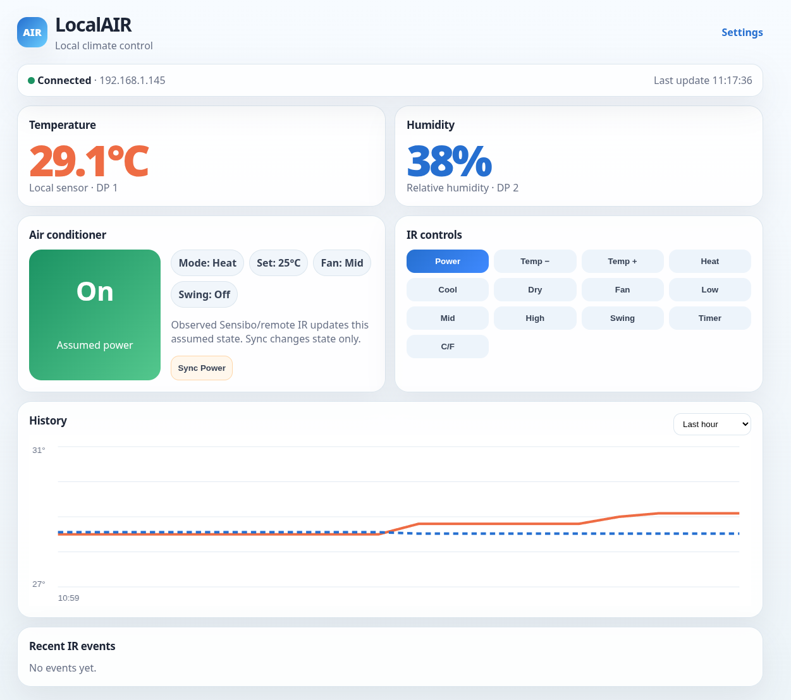
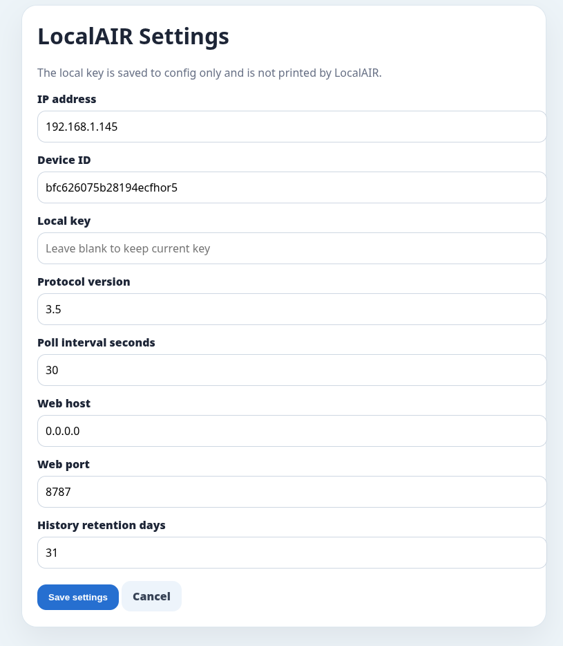

# LocalAIR

LocalAIR is an always-on Docker/Unraid web app for a local Tuya IR
temperature/humidity device.

It runs on your LAN and gives you a local dashboard for:

- temperature and humidity monitoring
- SQLite-backed history graphs
- Olimpia Splendid PIU14 power and 16–30 °C controls
- assumed AC state tracking
- Sync Power state correction

Sensor readings stay local. PIU14 control uses the Tuya cloud virtual remote
because this air conditioner does not use the old Kogan NEC command format.

You need these local device details:

- device IP address
- device ID
- local key
- protocol version

You also need the Tuya cloud region, API key, API secret, and the virtual
air-conditioner device ID shown as `Air` by the TinyTuya wizard.

## Supported devices

Temperature and humidity are read from a Tuya IR temperature/humidity remote
like:

```text
My AC / Tuya IR Temp Humidity Remote
```

The project was developed and tested with an Amazon Australia device listing:

```text
ASIN: B0CP775PDK
https://www.amazon.com.au/dp/B0CP775PDK
```

Listings for these Tuya devices can change names over time, so the important
technical details are the Tuya local protocol support and the DPS mapping below.

Known DPS mapping:

```text
DP 1 = temperature, divide by 10
DP 2 = humidity percentage
```

Power and temperature control targets the Olimpia Splendid PIU14 virtual AC
remote configured in Smart Life. The cloud project must remain active for
control commands.

## What you need before first start

You need these Tuya local-control values:

```toml
[device]
ip_address = "192.168.1.145"
device_id = "YOUR_DEVICE_ID"
local_key = "YOUR_LOCAL_KEY"
protocol_version = 3.5
```

The control settings are:

```toml
[tuya_cloud]
region = "eu"
api_key = "YOUR_TUYA_API_KEY"
api_secret = "YOUR_TUYA_API_SECRET"
aircon_device_id = "YOUR_VIRTUAL_AC_DEVICE_ID"
```

Daily climate control is disabled until enabled in Settings. Its defaults cool
at 24 °C, stop at 22 °C, and set the PIU14 to 16 °C between 10:00 and 16:00:

```toml
[climate]
enabled = false
start_time = "10:00"
end_time = "16:00"
turn_on_at = 24.0
turn_off_at = 22.0
aircon_temperature = 16
sensor_timeout_seconds = 120
```

The web UI can edit settings after the app is running, but the first launch
needs a valid `config.toml` mounted into the container.

## Getting Tuya device details

There are several ways to get the device ID, local key, IP address, and protocol
version.

Common options:

1. Use TinyTuya's wizard on a normal PC.
2. Use the Tuya IoT Platform with the Smart Life/Tuya app account.
3. Check your router/DHCP leases for the device IP address.
4. Use an existing known working TinyTuya config if you already have one.

TinyTuya wizard example:

```sh
python3 -m venv .venv
.venv/bin/pip install tinytuya
.venv/bin/python -m tinytuya wizard
```

The wizard normally helps discover devices and produce values like:

```text
Device ID
Local Key
IP Address
Version
```

For this app, put those values into `config.toml`.

Notes:

- Do not commit or publish your real local key.
- The local key is not printed by LocalAIR.
- The web Settings page leaves the local-key field blank; submitting a blank key
  keeps the existing key.

## Recommended Unraid layout

Use two separate folders:

```text
/mnt/user/appdata/localair      runtime data: config, database, logs
/mnt/user/appdata/localAIR      cloned source repo and Docker build files
```

Do not delete `/mnt/user/appdata/localair` unless you intentionally want to
remove your config and history database.

## Install on Unraid from a cloned repo

Clone the repo:

```sh
cd /mnt/user/appdata
git clone https://codeberg.org/Vyrnexis/localAIR.git localAIR
cd /mnt/user/appdata/localAIR
```

Create the runtime appdata folder:

```sh
mkdir -p /mnt/user/appdata/localair
cp -n config.example.toml /mnt/user/appdata/localair/config.toml
chmod 600 /mnt/user/appdata/localair/config.toml
```

Edit the config:

```sh
nano /mnt/user/appdata/localair/config.toml
```

At minimum, set:

```toml
[device]
ip_address = "YOUR_DEVICE_IP"
device_id = "YOUR_DEVICE_ID"
local_key = "YOUR_LOCAL_KEY"
protocol_version = 3.5
```

Build the local Docker image:

```sh
docker build -t localair:latest .
```

Install the local Unraid template:

```sh
mkdir -p /boot/config/plugins/dockerMan/templates-user

cp /mnt/user/appdata/localAIR/unraid/localair-local.xml \
  /boot/config/plugins/dockerMan/templates-user/my-localair.xml
```

Then in the Unraid web UI:

```text
Docker → Add Container → Template dropdown → LocalAIR
```

Confirm these template values:

```text
Repository: localair:latest
Network Type: Host
Appdata: /mnt/user/appdata/localair -> /data
Web UI Port: 8787
Timezone: your local timezone, e.g. Australia/Perth
```

Apply the template, then open:

```text
http://YOUR_UNRAID_IP:8787
```

When using the local template, Unraid may show `Version: not available` in the
Docker tab. That is normal for locally built images. Version/update checks only
work once the template points at a public registry image.

## Manual Docker run

If you do not want to use the Unraid template yet:

```sh
docker build -t localair:latest .

docker run -d \
  --name localair \
  --restart unless-stopped \
  --network host \
  --log-opt max-size=10m \
  --log-opt max-file=3 \
  -e LOCALAIR_DATA=/data \
  -e LOCALAIR_PORT=8787 \
  -e TZ=Australia/Perth \
  -v /mnt/user/appdata/localair:/data \
  localair:latest
```

Useful commands:

```sh
docker logs -f localair
docker restart localair
docker stop localair
docker rm localair
```

Raw `docker run` works, but Unraid will not know the icon/WebUI/template
metadata. Use the Unraid template if you want proper Unraid UI integration.

## Updating on Unraid

From the source folder:

```sh
cd /mnt/user/appdata/localAIR
git pull
docker build -t localair:latest .
```

If the container already exists, restarting may not use the newly built image.
Docker containers keep using the image ID they were created from. To guarantee
the new image is used, remove and recreate the container from the Unraid
template:

```sh
docker stop LocalAIR || docker stop localair
docker rm LocalAIR || docker rm localair
```

Then use:

```text
Docker → Add Container → Template dropdown → LocalAIR → Apply
```

If the container was created manually with `docker run`:

```sh
docker stop localair
docker rm localair

docker run -d \
  --name localair \
  --restart unless-stopped \
  --network host \
  --log-opt max-size=10m \
  --log-opt max-file=3 \
  -e LOCALAIR_DATA=/data \
  -e LOCALAIR_PORT=8787 \
  -e TZ=Australia/Perth \
  -v /mnt/user/appdata/localair:/data \
  localair:latest
```

## Docker logs

LocalAIR disables Uvicorn HTTP access logs by default. This prevents normal
dashboard polling from constantly filling Docker logs. The Unraid templates and
manual `docker run` examples also cap Docker logs to three 10 MB files.

If you need temporary HTTP request logging for debugging, set:

```text
LOCALAIR_ACCESS_LOG=true
```

## Web Settings page

After LocalAIR is running, open:

```text
http://YOUR_UNRAID_IP:8787/settings
```

The Settings page can update:

- IP address
- device ID
- local key
- protocol version
- poll interval
- web host
- web port
- history retention days
- climate-control enable switch, schedule, thresholds, and PIU14 setpoint

Important:

- If the local-key field is left blank, LocalAIR keeps the existing saved key.
- Changing the web port may require restarting the container.
- The app stores changes back to `/data/config.toml`.
- Timezone is a Docker/Unraid environment variable named `TZ`, not a web setting.
  Set it in the Unraid template. Example: `Australia/Perth`.

## Configuration file

Docker uses:

```text
/data/config.toml
```

On Unraid this is:

```text
/mnt/user/appdata/localair/config.toml
```

Example:

```toml
[device]
ip_address = "192.168.1.145"
device_id = "bfc626075b28194ecfhor5"
local_key = "REPLACE_WITH_YOUR_LOCAL_KEY"
protocol_version = 3.5
poll_interval_seconds = 30

[tuya_cloud]
region = "eu"
api_key = "REPLACE_WITH_YOUR_TUYA_API_KEY"
api_secret = "REPLACE_WITH_YOUR_TUYA_API_SECRET"
aircon_device_id = "REPLACE_WITH_YOUR_VIRTUAL_AC_DEVICE_ID"

[climate]
enabled = false
start_time = "10:00"
end_time = "16:00"
turn_on_at = 24.0
turn_off_at = 22.0
aircon_temperature = 16
sensor_timeout_seconds = 120

[server]
host = "0.0.0.0"
port = 8787

[history]
retention_days = 31

[ac_state]
power = "off"
temperature = "24"
```

## Data storage

The appdata folder contains:

```text
config.toml       device/settings config
localair.db       SQLite history database
unknown-ir.log    unknown observed IR signals
```

SQLite stores raw sensor readings, IR events, and AC state history for 31 days by default. Larger graph ranges
are down-sampled before being sent to the browser.

## Web dashboard

The dashboard includes:

- connection and last-update status
- large temperature and humidity cards
- AC assumed state card
- PIU14 power and temperature buttons
- daily scheduled climate control with configurable hysteresis
- fixed-window history scales with climate thresholds and AC event tooltips
- automatic, manual, and error activity filters
- explicit local-only assumed power correction
- temperature/humidity history graph with 24-hour, 7-day, and 30-day views
- recent activity list with IR events and device errors/disconnects
- settings page

The Sync Power button only changes LocalAIR's saved power state. It does not
send a command.

### Screenshots

Main dashboard:



Settings page:



## AC state behavior

LocalAIR sends `power` and direct 16–30 °C `temp` commands through Tuya's
infrared air-conditioner API. Because IR is one-way, LocalAIR
tracks an assumed state. It updates that state when:

- LocalAIR successfully sends an AC command
- you press Sync Power

When climate control is enabled, LocalAIR turns cooling on at or above the
configured upper threshold and off at or below the lower threshold. It always
turns the AC off outside the daily schedule or when sensor data is stale.

Unknown observed IR signals are logged to:

```text
/data/unknown-ir.log
```

## Testing the device from inside the container

If the web UI loads but the device does not connect:

```sh
docker exec -it localair python scripts/read_device.py
```

If your Unraid template created a container named `LocalAIR`, use:

```sh
docker exec -it LocalAIR python scripts/read_device.py
```

Also confirm Unraid can reach the device:

```sh
ping -c 3 YOUR_DEVICE_IP
```

Common causes of connection failure:

- missing or wrong local key
- wrong device IP
- wrong device ID
- wrong protocol version
- device moved to another Wi-Fi network/VLAN
- another client holding the Tuya connection open

## Local development

Install dependencies:

```sh
python3 -m venv .venv
.venv/bin/pip install -r requirements.txt
```

Run the web app:

```sh
LOCALAIR_DATA=/tmp/localair .venv/bin/python -m src.web_main
```

Run tests:

```sh
python3 -m unittest
```

## Project structure

```text
src/config.py      TOML config, data paths, secure saving
src/device.py      Tuya reads, IR send/listen logic, state updates
src/storage.py     SQLite history and event storage
src/web.py         FastAPI dashboard and JSON API
src/web_main.py    web server entry point
scripts/           helper scripts
tests/             core tests
unraid/            Unraid templates and icon
```

## License

LocalAIR is released under the MIT License. See `LICENSE`.
