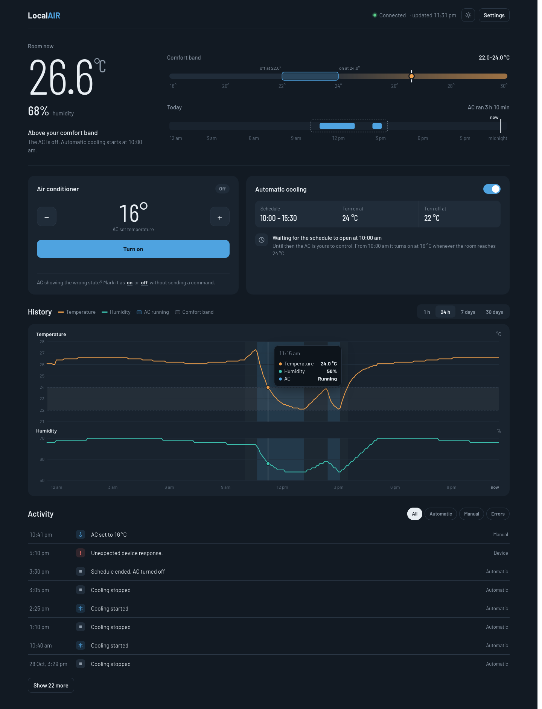
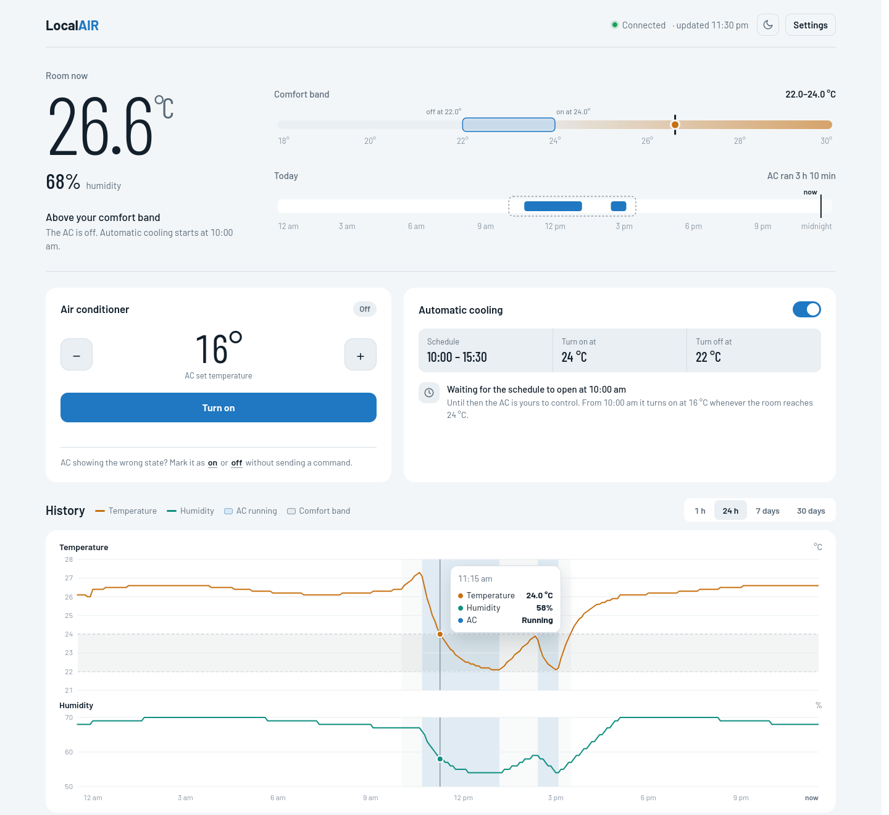
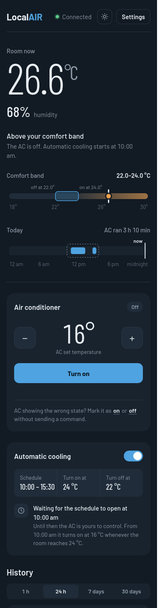
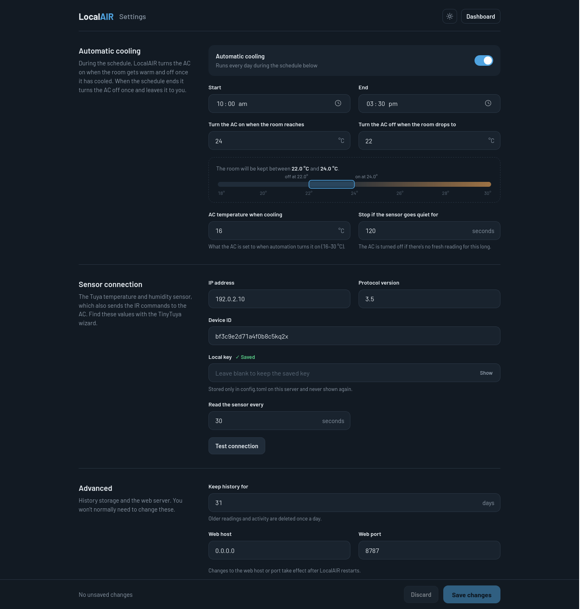
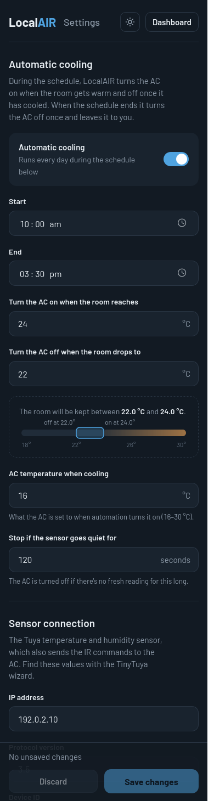

# LocalAIR

[](https://github.com/Vyrnexis/LocalAir/actions/workflows/docker.yml)

A small, always-on web app that watches the temperature in a room and switches
an Olimpia Splendid PIU14 air conditioner on and off to keep it in a comfort
band — entirely on your local network, with no cloud account involved.

It reads a Tuya IR temperature/humidity sensor over the LAN and uses the same
device's IR blaster to send commands to the AC. It runs as a Docker container
and is built to sit on an Unraid server.



## What it does

- **Shows the room at a glance.** Temperature, humidity, where the room sits
  against your comfort band, and a timeline of when the AC ran today.
- **Cools on a schedule.** During the hours you choose, it turns the AC on when
  the room gets warm and off once it has cooled. When the schedule ends it turns
  the AC off once and hands control back to you.
- **Lets you control the AC directly.** Power and 16–30 °C from any browser on
  your network, phone included.
- **Keeps history.** Linked temperature and humidity charts for the last hour,
  day, week or month, with the comfort band, schedule and AC running periods
  marked. Readings are kept for 31 days by default.
- **Stays local.** Sensor readings and AC commands never leave your network.
  The web UI, fonts included, is served by LocalAIR itself.

<table>
  <tr>
    <td width="66%"></td>
    <td></td>
  </tr>
  <tr>
    <td></td>
    <td></td>
  </tr>
</table>

## How automatic cooling works

With the defaults — schedule 10:00 to 15:30, on at 24 °C, off at 22 °C, AC set
to 16 °C:

| When | What LocalAIR does |
| --- | --- |
| Before 10:00 | Nothing. The AC is yours to control. |
| 10:00 – 15:30, room reaches 24 °C | Turns the AC on, cooling at 16 °C. |
| 10:00 – 15:30, room drops to 22 °C | Turns the AC off. |
| 10:00 – 15:30, between 22 and 24 °C | Leaves the AC as it is. |
| 10:00 – 15:30, no sensor reading for 2 minutes | Turns the AC off until readings return. |
| 15:30 | Turns the AC off once. |
| After 15:30 | Nothing. The AC is yours to control again. |

Automatic cooling is off until you switch it on, either on the dashboard or in
Settings. Inside the schedule it may override manual changes when the room
crosses a threshold; outside the schedule it never does.

IR is one-way, so LocalAIR can't ask the AC what it's doing. It keeps track of
the state it last sent. If someone uses the AC's own remote, use
**Mark it as on / off** on the dashboard to correct LocalAIR without sending a
command.

## What you need

**A Tuya IR temperature/humidity sensor** that supports Tuya's local protocol.
LocalAIR was developed with this device (listing names change, so the
important part is local protocol support and the data points below):

```text
"My AC / Tuya IR Temp Humidity Remote"
Amazon Australia, ASIN B0CP775PDK — https://www.amazon.com.au/dp/B0CP775PDK

DP 1 = temperature × 10
DP 2 = humidity %
```

**An Olimpia Splendid PIU14.** LocalAIR ships with learned IR codes for this
unit (cooling at 16–30 °C, and power off).

**The sensor's local details:** IP address, device ID, local key and protocol
version (usually 3.5). The easiest way to get them is the TinyTuya wizard on
any computer:

```sh
python3 -m venv .venv
.venv/bin/pip install tinytuya
.venv/bin/python -m tinytuya wizard
```

It needs the API key and secret of a free Tuya IoT Platform project linked to
your Smart Life / Tuya app account, and prints each device's ID, local key, IP
and version. Your router's
DHCP leases also show the IP. Give the sensor a fixed IP reservation so it
doesn't move.

Keep the local key private; anyone with it can control the device.

## Install on Unraid

GitHub Actions builds and publishes the image to
`ghcr.io/vyrnexis/localair` on every change, so there's nothing to build.

1. Open a terminal on the Unraid server and add the template:

   ```sh
   mkdir -p /boot/config/plugins/dockerMan/templates-user
   wget -O /boot/config/plugins/dockerMan/templates-user/my-localair.xml \
     https://raw.githubusercontent.com/Vyrnexis/LocalAir/main/unraid/localair.xml
   ```

2. Go to **Docker → Add Container**, choose **LocalAIR** from the Template list.

3. Set **Timezone** to yours (for example `Australia/Perth`) and click
   **Apply**. Leave the other fields as they are.

4. Open `http://YOUR_UNRAID_IP:8787`, go to **Settings**, enter the sensor's
   details and click **Test connection**, then **Save changes**.

Updates appear in Unraid's Docker tab; click **Update** on LocalAIR to install
one. Your settings and history live in `/mnt/user/appdata/localair` and are
kept across updates.

The container uses host networking so it can reach Tuya devices on the LAN.

## Install with Docker or Docker Compose

```sh
docker run -d \
  --name localair \
  --restart unless-stopped \
  --network host \
  --log-opt max-size=10m --log-opt max-file=3 \
  -e TZ=Australia/Perth \
  -v /path/to/localair-data:/data \
  ghcr.io/vyrnexis/localair:latest
```

Or use the included [`docker-compose.yml`](docker-compose.yml) (change the
volume path for non-Unraid hosts), then `docker compose up -d`.

Then open `http://YOUR_HOST_IP:8787/settings` and enter the sensor's details.

To follow releases rather than every change on `main`, use a version tag such
as `ghcr.io/vyrnexis/localair:1.0` instead of `latest`.

## Configuration

Almost everything is set on the **Settings** page and saved to
`/data/config.toml`. You can also create that file before the first start from
[`config.example.toml`](config.example.toml).

| Section | Settings |
| --- | --- |
| Automatic cooling | On/off, daily start and end, turn-on and turn-off room temperatures, AC temperature while cooling, sensor timeout |
| Sensor connection | IP address, device ID, local key, protocol version, how often to read the sensor |
| Advanced | Days of history to keep, web host and port |

The local key is never shown or returned by the web UI. Leave the field blank
to keep the saved key.

Container environment variables:

| Variable | Default | Purpose |
| --- | --- | --- |
| `TZ` | `Etc/UTC` | Timezone for the schedule, charts and activity times. |
| `LOCALAIR_PORT` | `8787` | Web port. Overrides the Settings page. |
| `LOCALAIR_HOST` | `0.0.0.0` | Address to listen on. Overrides the Settings page. |
| `LOCALAIR_DATA` | `/data` | Folder for the config, database and logs. |
| `LOCALAIR_CONFIG` | `/data/config.toml` | Config file path. |
| `LOCALAIR_DB` | `/data/localair.db` | History database path. |
| `LOCALAIR_ACCESS_LOG` | `false` | Set to `true` to log every HTTP request while debugging. |

The data folder contains:

```text
config.toml      settings, including the local key (saved with mode 600)
localair.db      SQLite history: readings, AC commands, AC state changes
unknown-ir.log   IR signals the sensor saw but didn't recognise
```

## Troubleshooting

**The dashboard says Disconnected or shows a device error.** Check the details
with **Test connection** in Settings, or read the sensor from inside the
container:

```sh
docker exec -it LocalAIR python scripts/read_device.py
```

The usual causes are a wrong local key, IP, device ID or protocol version; the
sensor moving to another IP, Wi-Fi network or VLAN; or another app (such as
Home Assistant's Tuya Local) holding the sensor's only local connection.

**The AC and the dashboard disagree.** Use **Mark it as on / off** to correct
LocalAIR's record without sending anything.

**The schedule runs at the wrong time.** The schedule follows the container's
timezone, not your browser's. Set `TZ` in the container to your own timezone.

Logs are available with `docker logs -f LocalAIR`. HTTP request logging is off
by default to keep the log quiet; set `LOCALAIR_ACCESS_LOG=true` to turn it on.

## Building it yourself

```sh
git clone https://github.com/Vyrnexis/LocalAir.git
cd LocalAir
docker build -t localair:latest .
```

On Unraid, use [`unraid/localair-local.xml`](unraid/localair-local.xml) for a
locally built image. Unraid can't check a local image for updates, so rebuild
and recreate the container to update.

## Development

```sh
python3 -m venv .venv
.venv/bin/pip install -r requirements.txt
LOCALAIR_DATA=/tmp/localair .venv/bin/python -m src.web_main   # http://localhost:8787
.venv/bin/python -m unittest
```

```text
src/config.py         settings file: load, validate, save
src/device.py         Tuya sensor reads, IR sending, automatic cooling decisions
src/storage.py        SQLite history and activity
src/web.py            FastAPI service and JSON API
src/static/           dashboard and Settings pages (HTML, CSS, JS, fonts)
src/piu14_ir_codes.json  learned PIU14 IR codes
scripts/read_device.py   one-off sensor read for troubleshooting
unraid/               Unraid templates and icon
```

Pull requests and pushes to `main` run the tests. Pushes to `main` publish
`ghcr.io/vyrnexis/localair:latest`; tags like `v1.2.0` also publish `1.2.0`
and `1.2`. See [`unraid/README.md`](unraid/README.md) for releasing.

## License

LocalAIR is released under the MIT License; see [`LICENSE`](LICENSE). The
bundled Barlow font is licensed under the SIL Open Font License; see
[`src/static/fonts/OFL.txt`](src/static/fonts/OFL.txt).
